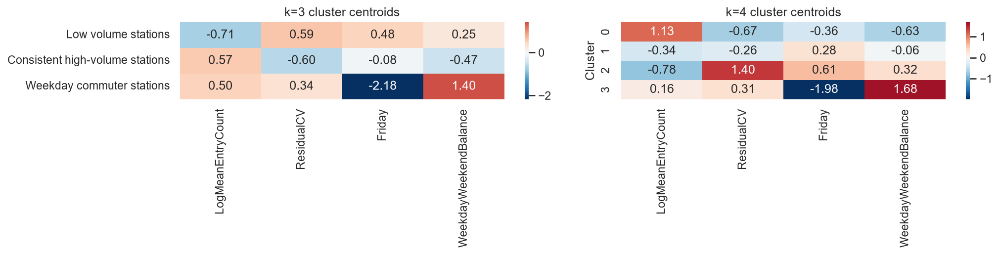
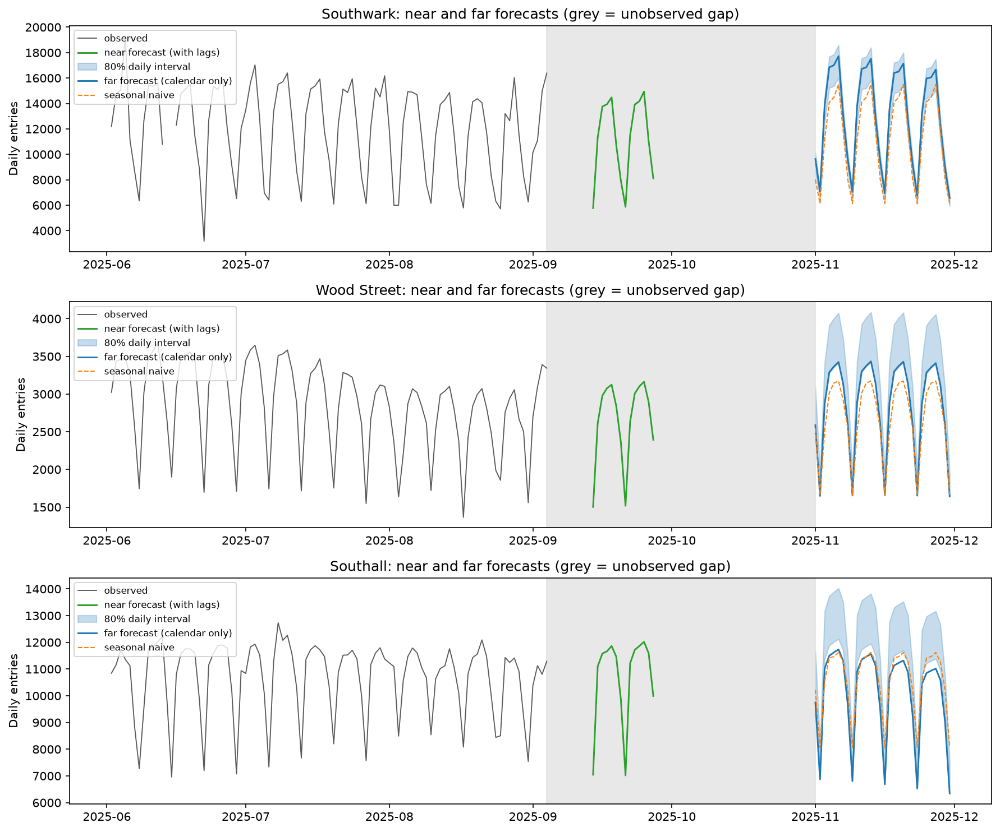

# TfL station demand: segmentation and forecasting

[](https://github.com/psyme95/tfl-station-demand/actions/workflows/tests.yml)

This project groups 434 London rail stations by their daily usage pattern and forecasts daily entries for one representative station per group for November 2025, from data that end eight weeks earlier. Station usage was found to form a continuum, and a three-group segmentation was retained as a convenient division of it. A calendar-only Poisson generalised linear model (GLM) outperformed a seasonal naive benchmark at the commuter station but under-predicted at two stations that grew during 2025, where a year-on-year benchmark was more accurate. Forecast intervals were derived from backtest errors and their coverage was checked.

## 1. Data

The data are Transport for London (TfL) station footfall counts: daily entry and exit taps for London Underground, DLR, London Overground and Elizabeth line stations, published by TfL as open data. Powered by TfL Open Data.

| | |
|---|---|
| Records | 266,744 station-days |
| Stations | 434, after merging three Elizabeth line stations recorded under two names |
| Period | 1 January 2024 to 13 September 2025 (622 days) |
| Coverage | mean 98.8% of days per station; minimum 67.0% (Colindale) |

An RMT strike affected Underground and DLR services from 8 to 12 September 2025, and the strike week is excluded from features and model training.

## 2. Methods

### 2.1 Segmentation

Each station was described by four features: log10 mean daily entries; day-to-day variability after dividing each day by the station's mean for that weekday (`ResidualCV`); Friday's share of the weekly total; and the ratio of mean weekday to mean weekend share. Features were standardised and clustered with k-means. The number of clusters was assessed with the silhouette, Calinski-Harabasz and Davies-Bouldin indices, and the partition was compared with Ward hierarchical clustering, DBSCAN and two structureless reference distributions (independently permuted features and a correlated Gaussian), following the logic of the gap statistic (Tibshirani et al., 2001).

### 2.2 Forecasting

For each representative station, days falling outside 0.25 to 1.75 times the station's median for that weekday were treated as disrupted and excluded from training, with medians computed only from data available at the forecast origin. Bank holidays were exempt from this filter.

Four models were compared with two benchmarks:

- `naive`: day-of-week means over the eight weeks before the origin.
- `yearly`: the same weekday 364 days earlier, scaled by the year-on-year change in level over the last eight weeks.
- `poisson`: a Poisson GLM with a log link, using day-of-week indicators, Fourier terms for the annual cycle (Hyndman and Athanasopoulos, 2021) and holiday indicators.
- `lognormal`: ridge regression on log entries, back-transformed with the smearing estimate (Duan, 1983).
- `xgb`: gradient-boosted trees with a Poisson objective (Chen and Guestrin, 2016), lightly tuned.

All model features are known exactly for any future date, which suits the eight-week gap between the last observation and the forecast window. Lag features were assessed separately using a direct multi-step strategy (Ben Taieb et al., 2012).

### 2.3 Validation

Models were evaluated by rolling-origin backtests (Tashman, 2000) in which each origin forecasts a 30-day window starting 58 days ahead, matching the November task. Twelve origins were used, 15 days apart, each with at least a year of training data so that every annual phase had been observed once, as for the real forecast. The number of Fourier harmonics and the XGBoost settings were chosen on the six earliest origins, and accuracy is reported on the six latest. Accuracy is expressed as mean absolute error (MAE) relative to the seasonal naive benchmark, and was computed both on undisrupted days and on all observed days.

### 2.4 Intervals

Daily 80% intervals were taken from the 10th and 90th percentiles of pooled backtest log residuals. Monthly 80% intervals were formed from split-conformal bounds (Vovk et al., 2005) on the ratio of actual to predicted monthly totals across origins; with twelve origins these are the smallest and largest observed ratios. Coverage was checked by leaving out one origin at a time.

## 3. Results

### 3.1 Segmentation

The peak silhouette of 0.266 at k = 3 indicates weak structure (Kaufman and Rousseeuw, 1990). It exceeds the structureless references by 0.038 to 0.045, and DBSCAN found no density-separated groups at any radius. The three groups are therefore best regarded as a segmentation of a continuous feature space.

**Table 1.** k-means clusters at k = 3. Entries per day are centroid values back-transformed from log10, so they are geometric means.

| Cluster | n | Entries/day | Residual CV | Friday share | Weekday:weekend |
|---|---|---|---|---|---|
| Weekday commuter | 35 | 8,366 | 0.222 | 0.138 | 2.02 |
| Low volume | 191 | 2,341 | 0.242 | 0.157 | 1.59 |
| Consistent high volume | 208 | 8,989 | 0.150 | 0.153 | 1.32 |



**Figure 1.** k-means centroids on the four standardised features at k = 3 (left, the partition used) and k = 4 (right). Values are standard deviations from the network mean.

The commuter cluster combines central workplace stations (Southwark, Bank, St James's Park, Canary Wharf) with outer commuter-belt origins (Amersham, Shenfield, Maidenhead). Its low Friday share (0.138) is consistent with hybrid working concentrated on Tuesday to Thursday. Ward clustering reproduced the high-volume cluster almost exactly and most of the commuter cluster, but divided the low-volume cluster, giving an adjusted Rand index of 0.446.

### 3.2 Forecast accuracy

The representative stations, the eligible stations nearest each centroid, were Southwark (commuter), Wood Street (low volume) and Southall (high volume).

**Table 2.** MAE relative to seasonal naive on the six held-out backtest origins (target windows from late May to mid-September 2025). Values below 1 indicate an improvement on the benchmark.

| Model | Southwark | Wood Street | Southall |
|---|---|---|---|
| Seasonal naive | 1.000 | 1.000 | 1.000 |
| Year-on-year naive | 1.304 | 0.811 | 0.927 |
| Poisson GLM | 0.832 | 1.302 | 1.328 |
| Log-normal | 0.968 | 1.222 | 1.170 |
| XGBoost | 0.877 | 1.143 | 1.376 |

The GLM was the most accurate method at Southwark. At Wood Street and Southall all fitted models under-predicted by 7% to 9%, and the year-on-year benchmark was the most accurate. Southall's entries grew by 9.1% year on year, which a model with calendar terms only cannot represent, and its residuals retained autocorrelation up to lag 91. Restricting the backtests to origins with a full year of training data proved important: from a September 2024 origin, with no November yet observed, the GLM's November 2024 bias ranged from -19% to +42% and seasonal naive was more accurate at every station.

### 3.3 November 2025 forecasts

**Table 3.** Forecast total entries for 1 to 30 November 2025, with the empirical 80% interval and both benchmarks.

| Station | Poisson GLM | 80% interval | Seasonal naive | Year-on-year naive |
|---|---|---|---|---|
| Southwark | 387,765 | 353,831 to 398,509 | 338,998 | 387,584 |
| Wood Street | 85,625 | 88,876 to 97,922 | 80,072 | 93,712 |
| Southall | 303,089 | 324,037 to 349,044 | 316,659 | 315,485 |



**Figure 2.** Observed daily entries from June 2025 (grey), the near forecast for 14 to 27 September with lag features (green), and the November forecast (blue) with its 80% daily interval and the seasonal naive benchmark (orange, dashed). The shaded band marks the unobserved period between the 4 September origin and 1 November.

At Southwark the GLM and year-on-year totals agree, and the 14.4% uplift over seasonal naive matches the 14.6% rise from the summer weeks to November observed in 2024. At Wood Street and Southall every backtest origin under-predicted, so the monthly interval lies wholly above the GLM point forecast. On this evidence the year-on-year benchmark is likely the better central estimate for those two stations. Leave-one-origin-out coverage of the nominal 80% intervals was 0.78 to 0.80 for daily values and 0.83 for monthly totals. The choice of the number of harmonics, which the selection origins could not resolve, moves the GLM totals by 5% to 9%.

## 4. Limitations

- The annual cycle rests on a single observed autumn. Pooling the seasonal shape across stations with a hierarchical model is the most promising extension.
- The calendar-only model has no level or trend term and cannot follow growth. A level term updated from recent observations would be expected to help at growing stations.
- Six selection and six held-out origins, which overlap, give considerable sampling uncertainty in all reported scores and leave the model settings poorly identified.
- Disrupted days are excluded from training, so the intervals describe undisrupted days. Engineering closures and events such as Bonfire Night (5 November) are not modelled.
- Daily totals cannot separate morning and evening peaks, which limits the segmentation of commuter stations.
- These forecasts are for illustration and have not been compared with observed November 2025 counts.

## 5. Repository structure and reproduction

```
data/raw/        TfL_Station_Counts.xlsx, the source data
data/processed/  intermediate tables written by the notebooks (not tracked)
outputs/         cluster labels and forecasts written by the notebooks (not tracked)
docs/figures/    figures used in this README, written by notebooks 3 and 4
notebooks/       the analysis, run in numerical order
src/tfl.py       shared data preparation, models, backtesting and interval code
tests/           unit tests on synthetic data
```

The analysis uses Python 3.13 with the pinned versions in `requirements.txt`.

```
python -m venv .venv
.venv\Scripts\activate          # macOS/Linux: source .venv/bin/activate
pip install -r requirements.txt
pytest
jupyter lab
```

Run the notebooks from the `notebooks/` folder in order. Each reads the outputs of the one before.

| Notebook | Reads | Writes |
|---|---|---|
| `1_EDA.ipynb` | `data/raw/TfL_Station_Counts.xlsx` | `data/processed/TfL_Data_Processed.csv` |
| `2_Cluster_Feature_Engineering.ipynb` | `data/processed/TfL_Data_Processed.csv` | `data/processed/TfL_Station_Features.csv` |
| `3_Station_Clustering.ipynb` | both processed files | `outputs/station_clustering_results.csv` |
| `4_Station_Forecasting.ipynb` | `data/processed/TfL_Data_Processed.csv`, the cluster results | `outputs/november_forecasts.csv` |

The notebooks are saved with their outputs, so the results can be read without running them.

## References

Ben Taieb, S., Bontempi, G., Atiya, A.F. and Sorjamaa, A. (2012) A review and comparison of strategies for multi-step ahead time series forecasting based on the NN5 forecasting competition. *Expert Systems with Applications*, 39(8), 7067-7083.

Chen, T. and Guestrin, C. (2016) XGBoost: a scalable tree boosting system. *Proceedings of the 22nd ACM SIGKDD International Conference on Knowledge Discovery and Data Mining*, 785-794.

Duan, N. (1983) Smearing estimate: a nonparametric retransformation method. *Journal of the American Statistical Association*, 78(383), 605-610.

Hyndman, R.J. and Athanasopoulos, G. (2021) *Forecasting: Principles and Practice*. 3rd edn. OTexts, Melbourne.

Kaufman, L. and Rousseeuw, P.J. (1990) *Finding Groups in Data: An Introduction to Cluster Analysis*. Wiley, New York.

Tashman, L.J. (2000) Out-of-sample tests of forecasting accuracy: an analysis and review. *International Journal of Forecasting*, 16(4), 437-450.

Tibshirani, R., Walther, G. and Hastie, T. (2001) Estimating the number of clusters in a data set via the gap statistic. *Journal of the Royal Statistical Society: Series B*, 63(2), 411-423.

Vovk, V., Gammerman, A. and Shafer, G. (2005) *Algorithmic Learning in a Random World*. Springer, New York.

## Licence

The code is released under the MIT Licence. The data are TfL open data and remain subject to TfL's terms.
